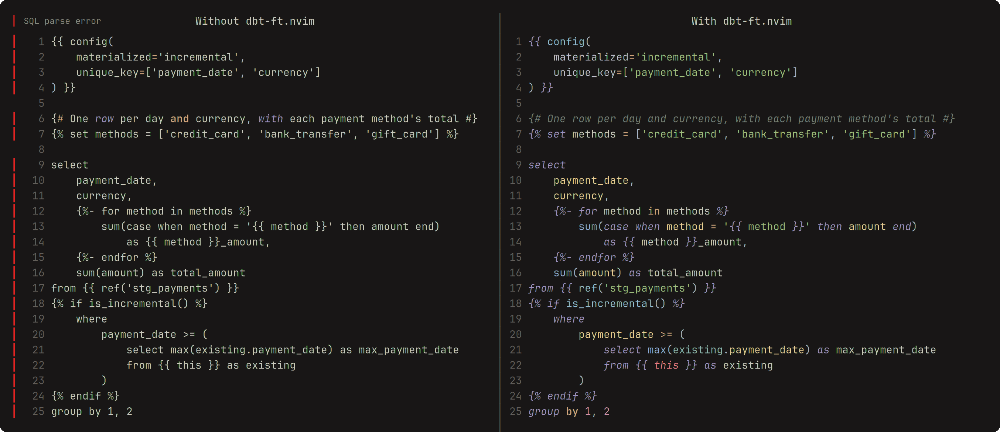

# dbt-ft.nvim

A Jinja-aware filetype for [dbt](https://www.getdbt.com/) models in Neovim.

Neovim opens dbt models as plain SQL, so the SQL parser trips over every `{{ ref() }}` and none of
the Jinja is highlighted. dbt-ft.nvim gives models their own `dbt` filetype, which Tree-sitter
parses as Jinja with the SQL between the tags handed to the SQL parser. Highlighting, folding, and
indenting then understand both languages, and a `dbt` buffer still gets what Neovim gives a `sql`
buffer.



There are no commands and no setup function.

## Features

- `.sql` files in a dbt project get the `dbt` filetype, except dbt's compiled output in `target/`.
- The SQL around the Jinja tags, and each `{{ }}` expression, go to the SQL parser as one document,
  so `from {{ ref('orders') }} where` parses and highlights as SQL.
- dbt's functions and context variables, such as `ref`, `config`, `this`, and `target`, highlight as
  built-ins, so they stand out from your own macros.
- With Tree-sitter folding and indenting on, Jinja blocks fold, and SQL keeps its folds and indents.
- The indent and `'textwidth'` follow the project's SQLFluff config, with dbt Labs' four spaces
  where it sets no indent. A project's EditorConfig overrides both.
- `gc` uses `{# #}` on a line that starts with a Jinja tag, indented or not, and `--` elsewhere.
- Enter or `o` on a `--` comment line starts the new line with `--` too.
- `%` moves between a Jinja block's tags, such as ``, ``, and ``.
- With yaml-language-server, a project's YAML gets dbt's schemas for validation, completion, and
  hover, even when the project's directory doesn't have `dbt` in its name.

See [`:help dbt-ft`](doc/dbt-ft.txt) for details and limitations.

## Requirements

- Neovim 0.12 or later.
- The `jinja`, `jinja_inline`, and `sql` Tree-sitter parsers, for example from
  [nvim-treesitter](https://github.com/nvim-treesitter/nvim-treesitter) with
  `:TSInstall jinja jinja_inline sql`.

## Installation

With `vim.pack`:

```lua
vim.pack.add({ "https://github.com/dobsontom/dbt-ft.nvim" })
```

With [lazy.nvim](https://github.com/folke/lazy.nvim):

```lua
{ "dobsontom/dbt-ft.nvim" }
```

Don't lazy-load it: it does almost nothing at startup, and it can't load on the `dbt` filetype,
which only it detects.

## Setup

LazyVim starts Tree-sitter for `dbt` buffers by itself. If your config starts it for a list of
filetypes, add `dbt` to the list:

```lua
vim.api.nvim_create_autocmd("FileType", {
  pattern = { "dbt", "sql" },
  callback = function()
    vim.treesitter.start()
  end,
})
```

Language servers, formatters, and linters set up for `sql` don't run on `dbt` buffers, which keeps
the ones that can't read Jinja off your models. Add `dbt` to those that can. See
[`:help dbt-ft-formatting`](doc/dbt-ft.txt) for conform.nvim and nvim-lint, as SQLFluff's `dbt`
templater can't read the buffer, and [`:help dbt-ft-snippets`](doc/dbt-ft.txt) for blink.cmp and
LuaSnip.

The dbt language server, `dbt lsp`, comes with dbt v2, not dbt-core 1.x. With
[nvim-lspconfig](https://github.com/neovim/nvim-lspconfig), whose `dbt` config already covers the
`dbt` filetype, enable it:

```lua
vim.lsp.enable("dbt")
```

See [`:help dbt-ft-lsp`](doc/dbt-ft.txt) for setting it up without nvim-lspconfig.

[dbtpal](https://github.com/PedramNavid/dbtpal) sets `'filetype'` back to `sql` on every `.sql` file
it reads, so the two don't work together.

Run `:checkhealth dbt-ft` to check the setup.

## Options

| Option                        | Set it to            | To                                                      |
| ----------------------------- | -------------------- | ------------------------------------------------------- |
| `vim.g.dbt_ft_yaml_schemas`   | `false` or `0`       | leave yaml-language-server's schema mappings alone      |
| `vim.g.dbt_recommended_style` | `false` or `0`       | keep your own indent and `'textwidth'` in `dbt` buffers |
| `vim.g.loaded_dbt_ft`         | `1`, before it loads | turn dbt-ft.nvim off                                    |

## Development

`make test` runs the tests, and builds the parsers they need on its first run, which needs Git, a C
compiler, and the [tree-sitter CLI](https://github.com/tree-sitter/tree-sitter). `make format` and
`make lint` also need [StyLua](https://github.com/JohnnyMorganz/StyLua),
[selene](https://github.com/Kampfkarren/selene),
[lua-language-server](https://github.com/LuaLS/lua-language-server),
[ts_query_ls](https://github.com/ribru17/ts_query_ls), [oxfmt](https://oxc.rs), and
[jq](https://jqlang.org). [prek](https://github.com/j178/prek) runs all three as Git hooks.

## Licence

[MIT](LICENSE)
